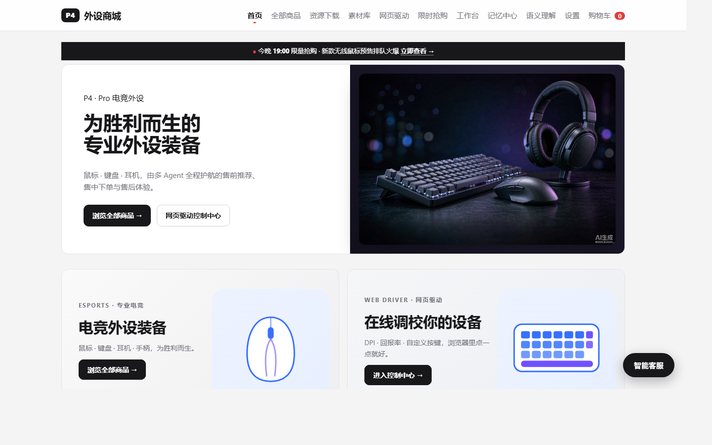
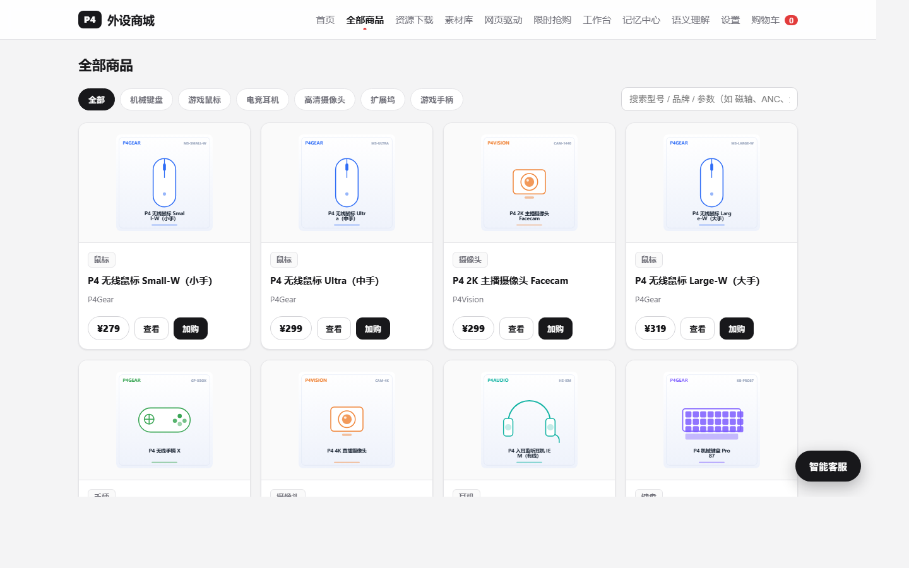
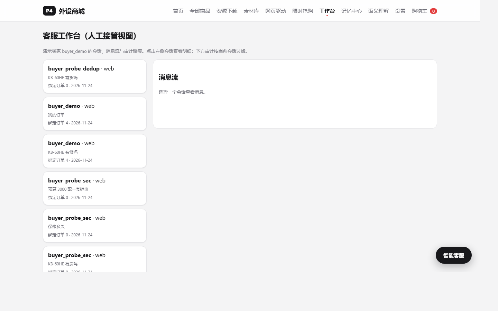
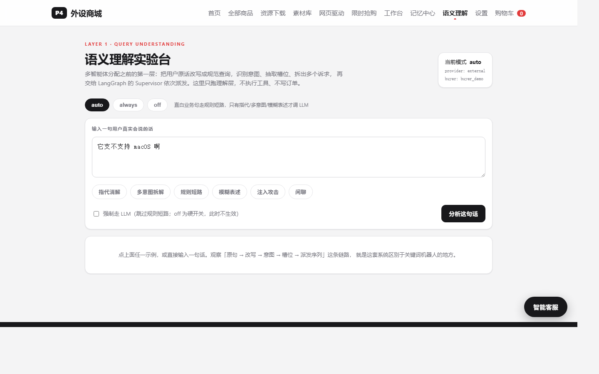
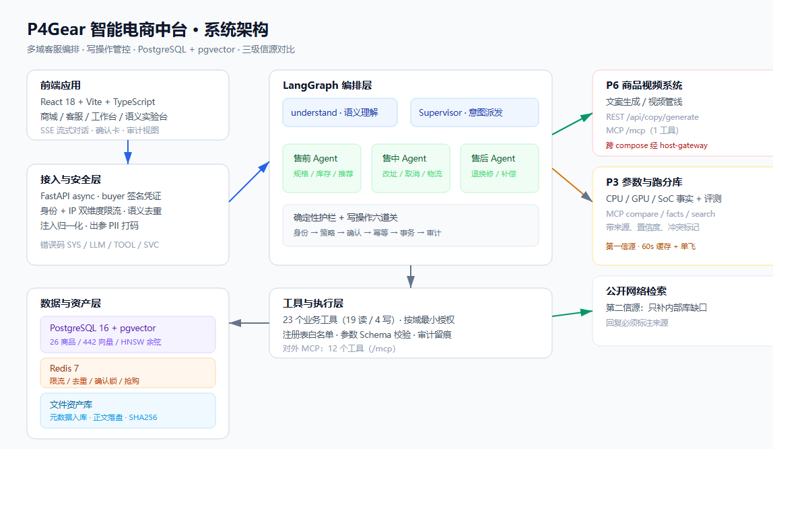

# P4Gear Commerce Agent

[简体中文](README.md) · **English** · [Architecture](docs/ARCHITECTURE.md) · [Docs Index](docs/README.md)

**P4Gear** is a multi-agent commerce platform for gaming-peripheral retail. It puts catalog, orders, knowledge and customer-service orchestration into one system that actually runs, is testable and is operable.

[](https://www.python.org/)
[](https://fastapi.tiangolo.com/)
[](https://react.dev/)
[](https://github.com/pgvector/pgvector)
[](LICENSE)
[](https://github.com/yeb1234/peripheral-mall-agent/actions/workflows/ci.yml)

---

## Overview

P4Gear ships a complete storefront backend and a customer-service frontend. The storefront covers browsing, product detail, search, checkout, driver downloads and flash sales. The service side runs three domain agents — pre-sales, in-sales and after-sales — that answer within their own scope, while every write action must clear six gates: identity, policy, confirmation, idempotency, transaction and audit.

The point is not "attach an LLM to a Q&A box", but to turn agent permissions, tool calls and data flow into **engineering constraints**: a model only sees tools registered to its domain, only cites conclusions produced by the policy engine, and never writes to the database directly. PostgreSQL + pgvector provide business storage and vector retrieval; Redis handles rate limiting, semantic deduplication and confirmation locks; a file asset store keeps manuals, resource packs and driver notes.

Two cross-system channels are included: product cards and copy are exchanged with the product-video system **P6** (REST + MCP), and CPU / GPU / SoC specs and benchmark facts with the **P3** parameter database (MCP). For strict comparisons the source order is fixed at **P3 internal facts → own catalog → public web**, and every result carries a source tag.

The current build is a runnable backend plus frontend on demo seed data. Production hardening — authn/authz, migrations, monitoring and capacity planning — together with known gaps, is tracked in the [Operations Runbook](docs/OPS_RUNBOOK.md).

## Features

**Storefront**
- 26 peripheral SKUs (keyboards, mice, headsets, cameras, docks, controllers) searchable by category, price and keyword
- Product detail, specifications, compatibility checks and bundle recommendations
- Checkout with stock deduction, order lookup, shipment tracking, return/exchange/repair intake
- Driver downloads with SHA256 verification, manuals and resource packs archived

**Service agents**
- Pre-sales: specs, stock, price, compatibility, build recommendations, cross-model comparison
- In-sales: address changes, order cancellation, shipment tracking, payment status
- After-sales: returns, exchanges, repairs, compensation decisions — all through the policy engine
- Multi-intent decomposition with serial dispatch and audited cross-domain handoff
- SSE streaming, confirmation cards, human handoff and unified error codes

**Data and retrieval**
- PostgreSQL 16 business database + pgvector index (1024-dim, HNSW cosine)
- 78 product documents → 416 sections → 442 vectors, with incremental rebuild
- 156 file assets (manuals, resources, driver bundles); metadata in DB, content on disk
- Redis rate limiting, semantic dedup, confirmation locks and flash-sale deduction

**Engineering and operations**
- 23 business tools (19 read / 4 write) with least privilege per domain; 12 tools exposed over MCP
- Static scan, structure self-check, dynamic security cases, bridge smoke, source smoke and load tests
- One-command Docker Compose stack; zero-dependency local mode on SQLite + memory
- Audit tables, health probes, structured error codes and observable SSE metadata

## Screenshots

| Storefront home | Product list |
| --- | --- |
|  |  |

| Service workbench | NLU lab |
| --- | --- |
|  |  |

## Architecture



Request path: frontend → access layer (auth / rate limit / dedup / injection normalization) → LangGraph orchestration (understand → supervisor → domain agent) → tool execution (registry + six gates) → data layer (PostgreSQL / pgvector / Redis / file assets).

Comparison requests additionally pass through source routing: P3 internal facts first, then the own catalog, and only then the public web — with the source annotated in the reply.

## Tech Stack

| Layer | Choice |
| --- | --- |
| Backend | Python 3.11, FastAPI, Pydantic v2, SQLAlchemy 2 async, asyncpg, sse-starlette |
| Orchestration | LangGraph `StateGraph`, contextvar runtime |
| Models | Unified OpenAI-protocol client: Mock (offline), OpenAI-compatible endpoint, local LM Studio, switchable at runtime |
| Retrieval | pgvector HNSW + keyword recall + SiliconFlow reranker (degradable) |
| Storage | PostgreSQL 16 (business + vectors), Redis 7 (rate limit / dedup / locks), local file asset volume |
| Frontend | React 18, Vite, TypeScript, hand-written SSE parser |
| Delivery | Docker Compose, GitHub Actions (lint + tests + build) |

## Getting Started

### Option 1: Docker Compose (recommended)

```bash
cp .env.example .env          # optional: set SILICONFLOW_API_KEY to enable vector retrieval
docker compose up -d --build
docker compose ps             # backend should be healthy
```

| Service | Address |
| --- | --- |
| Frontend | http://localhost:5173 |
| Backend API / docs | http://localhost:8000 / http://localhost:8000/docs |
| PostgreSQL | 127.0.0.1:12500 (p4 / p4pass, database `p4agent`) |
| Redis | 127.0.0.1:12600 |

First boot creates tables, seeds demo data (26 products, 78 documents, 4 demo orders, 9 policies) and, when an embedding key is configured, indexes 442 vectors.

### Option 2: Local development (zero dependencies)

```bash
cd backend
python -m venv .venv && source .venv/bin/activate    # Windows: .venv\Scripts\activate
pip install -r requirements.txt
cp ../.env.example .env
uvicorn app.main:app --reload --port 8000

# in another terminal
cd frontend
npm install
npm run dev -- --port 5173
```

Defaults are `DATABASE_URL=sqlite+aiosqlite:///./p4agent.db`, `CACHE_BACKEND=memory` and `LLM_BACKEND=mock`, so the whole orchestration runs without Docker or API keys. To exercise the PostgreSQL + pgvector path, point `DATABASE_URL` at port 12500, set `CACHE_BACKEND=redis` and `REDIS_URL=redis://127.0.0.1:12600/0`, then restart.

## Configuration

Configuration lives in `backend/app/config.py` and is overridden by environment variables or `backend/.env`. The full list is in [.env.example](.env.example).

API keys live **only** in `backend/.env` (`OPENAI_API_KEY`, `LOCAL_LLM_API_KEY`, `SILICONFLOW_API_KEY`, `WEBSEARCH_API_KEY`, `TAVILY_API_KEY`); `backend/llm_config.json` keeps base_url / model only, and the settings page shows keys read-only.

| Variable | Default | Notes |
| --- | --- | --- |
| `DATABASE_URL` | `sqlite+aiosqlite:///./p4agent.db` | Business database; use `postgresql+asyncpg://...` in production |
| `CACHE_BACKEND` | `memory` | `redis` enables rate limiting, dedup and confirmation locks |
| `REDIS_URL` | `redis://localhost:6379/0` | `redis:6379/0` inside Compose, 12600 on the host |
| `LLM_BACKEND` | `mock` | `openai` for any OpenAI-protocol endpoint |
| `PGVECTOR_ENABLED` | `false` | Enable vector index and retrieval |
| `PGVECTOR_DIM` | `1024` | Must match the embedding model; changing it requires a table rebuild |
| `STORAGE_DIR` | `storage` | Root directory for file assets |
| `P6_BASE_URL` | `http://127.0.0.1:12706` | Product-video system address |
| `P3_MCP_URL` | `http://127.0.0.1:12415/mcp` | Parameter-fact MCP address |
| `P3_CACHE_TTL` | `60` | Seconds to reuse the same P3 parameter result |

## Key Endpoints

| Endpoint | Purpose |
| --- | --- |
| `POST /api/chat` | SSE service pipeline (token / meta / error / done) |
| `POST /api/chat/confirm` | Execute a confirmation card (idempotent + session lock) |
| `POST /api/nlu/analyze` | NLU only: rewrite / intent / slots / multi-intent |
| `GET /api/memory/snapshot` | User profile, orders, events, tasks and checkpoints |
| `GET /api/products` · `GET /api/products/{sku}` | Product list and detail |
| `GET /api/catalog/search` · `GET /api/catalog/{sku}/card` | Catalog search and aggregated product card (consumed by P6) |
| `GET /api/vector/status` · `POST /api/vector/reindex` · `GET /api/vector/search` | Vector index status / rebuild / search |
| `GET /api/files/manifest` · `GET /api/files/{id}` | File asset manifest and download |
| `GET /api/health` | Liveness, model, cache, RAG and retrieval capabilities |
| `POST /mcp` | P4 MCP server (12 tools) |

Full routes are available at `http://localhost:8000/docs`.

## Repository Layout

```
P4Gear/
├── backend/
│   ├── app/
│   │   ├── agents/          # LangGraph graphs, nodes, tool registry and executor
│   │   ├── core/            # security, policy, idempotency, rate limit, audit, vectors, external clients
│   │   ├── services/        # session, NLU, memory, RAG, files, source routing
│   │   ├── routers/         # REST / SSE / MCP endpoints
│   │   └── db/              # models, sessions, seed data
│   ├── scripts/             # full / security / bridge / source / load / structure checks
│   ├── tools/mcp_server.py  # outbound MCP server
│   └── Dockerfile
├── frontend/src/            # pages, service components, API client
├── ops/                     # deployment and observability config
├── p4-assets/               # product source data, images and copy
├── docs/
│   ├── images/              # architecture diagram and UI screenshots
│   ├── reports/             # machine-readable test and load reports
│   ├── ARCHITECTURE.md
│   ├── OPS_RUNBOOK.md
│   ├── P4-P6-BRIDGE.md
│   ├── P3-MCP-INTEGRATION.md
│   ├── SOURCE-PRIORITY.md
│   └── README.md            # docs index
├── docker-compose.yml
└── .env.example
```

## Data & Storage

- **Business tables**: 16 (products, orders, inventory, policies, sessions, messages, tasks, audits, file assets and more), idempotently created on startup.
- **Vector table**: `doc_embeddings` created with native SQL, `vector(1024)` column with an HNSW cosine index; changing the embedding model requires stopping writes, altering the dimension, dropping the table and re-indexing.
- **File assets**: `file_assets` stores `rel_path`, `sha256`, `size` and origin, while content lives under `STORAGE_DIR`; back up the database and the volume separately, database first.
- **Seed data**: 26 products, 78 documents (416 sections), 78 driver bundles, 4 demo orders and 9 policies — all demo data, safe to rebuild.

## Testing & Quality

| Suite | Command | Current result |
| --- | --- | --- |
| Conversation end-to-end | `python backend/scripts/probe_full.py` | 22/22 |
| Dynamic security | `python backend/scripts/probe_security.py` | 36/36 |
| Cross-system bridge | `python backend/scripts/probe_bridge.py` | 13/13 |
| Source routing | `python backend/scripts/probe_sources.py` | 7/7 |
| Structure self-check | `python backend/scripts/check_structure.py` | 0 ERROR / 9 WARN |
| Static scan | `python backend/scripts/security_scan.py --strict` | 110 files, 0 FAIL / 3 WARN |
| Frontend build | `npm run build` (frontend) | exit 0 |

Performance baseline (local machine, 10 concurrent, 100 requests): product endpoint 303.8 rps, P50 29.8 ms, P95 55.8 ms, 0 errors; vector search 2.7 rps, P50 1.8 s — the bottleneck is online embedding per query, while pgvector itself answers in milliseconds. Reports are in [docs/reports](docs/reports/).

```bash
# load tests
python backend/scripts/loadtest.py --target products -c 10 -n 100
python backend/scripts/loadtest.py --target vector -c 5 -n 20
```

## Deployment & Operations

- Operations runbook: [docs/OPS_RUNBOOK.md](docs/OPS_RUNBOOK.md) (backup / restore / scaling / troubleshooting)
- Cross-system contract: [docs/P4-P6-BRIDGE.md](docs/P4-P6-BRIDGE.md)
- Source rules: [docs/SOURCE-PRIORITY.md](docs/SOURCE-PRIORITY.md)
- P3 integration: [docs/P3-MCP-INTEGRATION.md](docs/P3-MCP-INTEGRATION.md)
- Docs index: [docs/README.md](docs/README.md)

Ports: backend 8000, frontend 5173 (served by a node container inside Compose), database 12500, cache 12600; P6 at 12706, P3 MCP at 12415.

## Roadmap

- [ ] Vector query cache and local embeddings to bring retrieval P50 to ~50 ms
- [ ] Externalize all prompts as YAML, reduce structure-check WARNs to ≤3
- [ ] Add end-to-end cases for all 23 tools (22 covered today)
- [x] CI actually runs on the remote repository with build badges (backend + frontend green)
- [ ] Add a peripheral domain to P3 (switches, battery life, polling rate, keycaps) so peripheral comparisons hit the first source

## License

[MIT](LICENSE)
