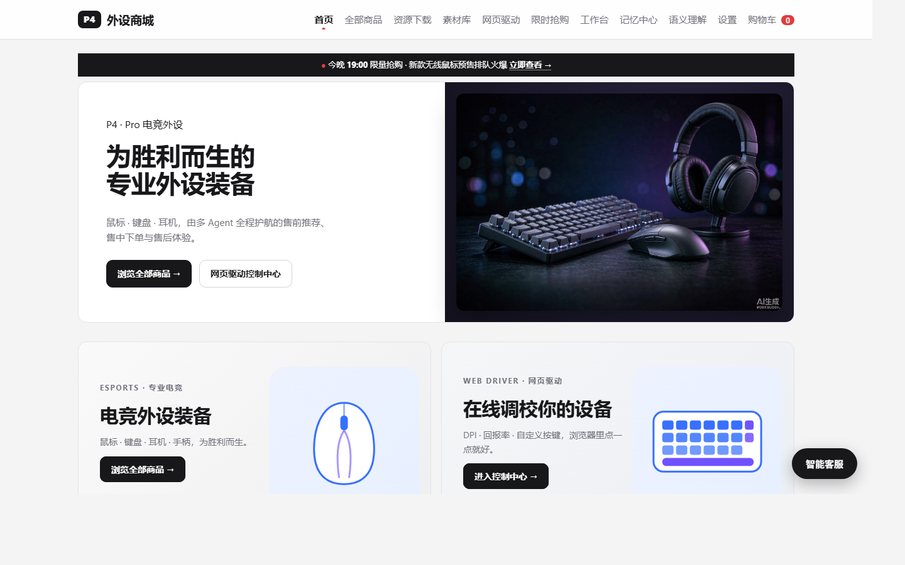
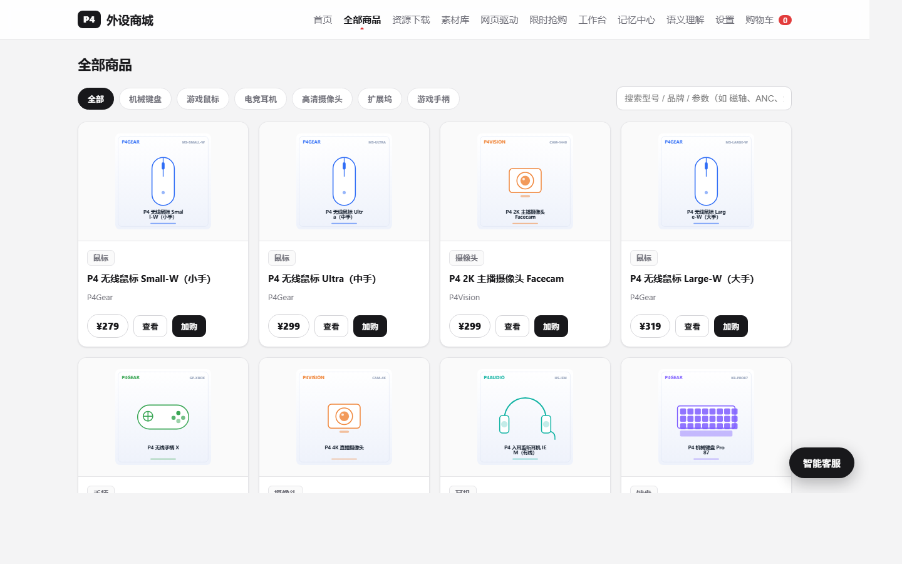
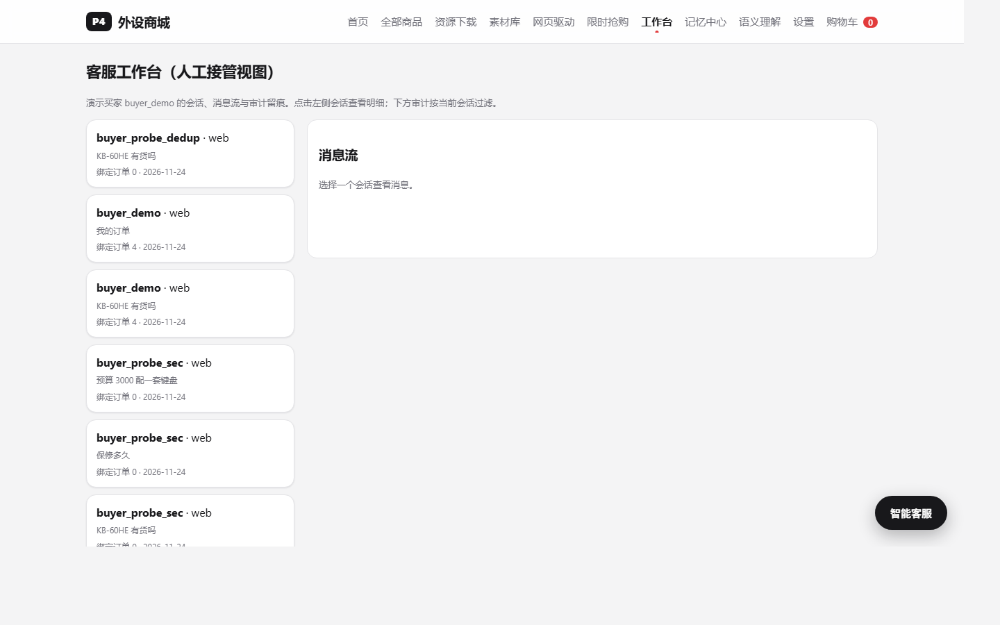
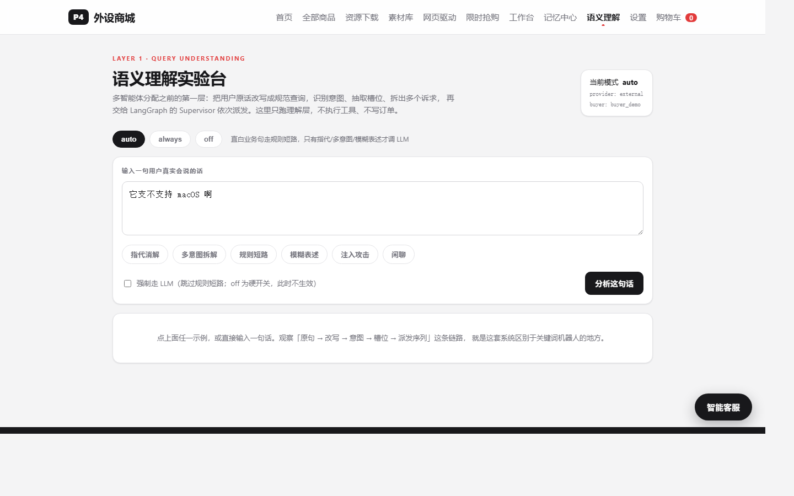
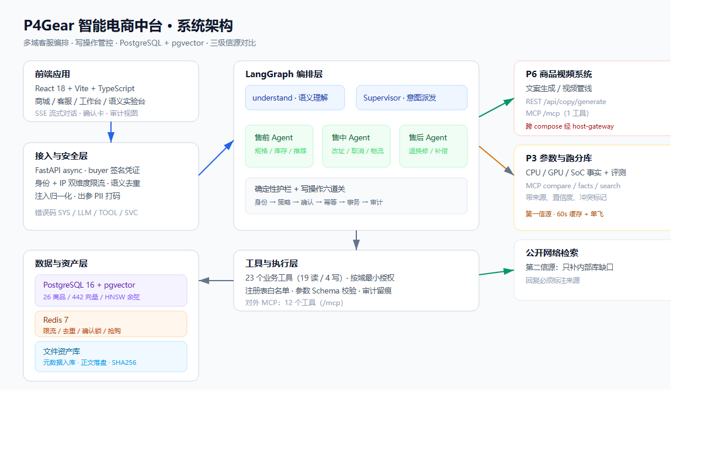

# P4Gear 智能电商中台

**简体中文** · [English](README.en.md) · [架构说明](docs/ARCHITECTURE.md) · [文档索引](docs/README.md)

**P4Gear Commerce Agent** —— 面向电竞外设零售的多 Agent 电商中台，把商品、订单、知识库与客服编排放在同一套可运行、可测试、可运维的系统里。

[](https://www.python.org/)
[](https://fastapi.tiangolo.com/)
[](https://react.dev/)
[](https://github.com/pgvector/pgvector)
[](LICENSE)
[](https://github.com/yeb1234/peripheral-mall-agent/actions/workflows/ci.yml)

---

## 项目简介

P4Gear 是一个完整的电商后端与客服前端示例：商城侧提供商品浏览、详情、搜索、下单、驱动下载与限时抢购；客服侧由三个按业务域拆分的 Agent（售前 / 售中 / 售后）协同应答，写操作必须经过身份、策略、二次确认、幂等、事务与审计六道关。

项目的重点不在「接一个大模型做问答」，而在**把 Agent 的权限边界、工具调用与数据链路做成工程约束**：模型只能看到本域的工具，只能引用策略引擎给出的结论，不能直接写库。配套 PostgreSQL + pgvector 做业务存储与向量检索，Redis 做限流、去重与确认锁，文件资产库保存说明书、资源包与驱动说明。

系统还提供两个跨系统通道：与商品视频系统 **P6** 交换商品卡与文案（REST + MCP），与参数/跑分事实库 **P3** 交换 CPU / GPU / SoC 的规格与评测数据（MCP）。涉及「哪个更强 / 哪个更值」的严格对比时，取值顺序固定为 **P3 内部事实 → 自营商品库 → 公开网络**，每层结果都带来源标记。

当前版本为可运行的服务端 + 前端，数据为演示种子数据；生产化所需的鉴权、迁移、监控与容量规划，以及当前的已知缺口，见 [运维手册](docs/OPS_RUNBOOK.md)。

## 功能特性

**商城**
- 26 个外设 SKU（键盘 / 鼠标 / 耳机 / 摄像头 / 扩展坞 / 手柄），按品类、价格、关键词检索
- 商品详情、规格参数、兼容性检查、套装推荐
- 下单与库存扣减、订单查询、物流查询、退换修受理
- 驱动下载与 SHA256 校验信息，说明书 / 资源包归档

**客服 Agent**
- 售前：规格、库存、价格、兼容性、配置推荐、跨型号对比
- 售中：改地址、取消订单、物流追踪、支付状态
- 售后：退货、换货、寄修、补偿判定，全部走策略引擎
- 多意图拆解与串行派发，跨域交接留审计
- SSE 流式输出，确认卡、转人工、错误码统一收口

**数据与检索**
- PostgreSQL 16 业务库 + pgvector 向量索引（1024 维，HNSW 余弦）
- 商品文档 78 份 → 416 个章节 → 442 条向量，支持增量重建
- 文件资产 156 个（说明书 / 资源 / 驱动说明包），元数据入库、正文落盘
- Redis 限流、语义去重、确认单锁与抢购扣减

**工程与运维**
- 23 个业务工具（19 读 / 4 写），按域最小授权；对外 MCP 12 个工具
- 静态扫描、结构自检、动态安全用例、桥接冒烟、信源冒烟、压测脚本
- Docker Compose 一键起全栈；本地支持 SQLite + memory 零依赖运行
- 审计表、健康探针、结构化错误码、SSE meta 可观测

## 界面预览

| 商城首页 | 商品列表 |
| --- | --- |
|  |  |

| 客服工作台 | 语义理解实验台 |
| --- | --- |
|  |  |

## 系统架构



请求路径：前端 → 接入层（鉴权 / 限流 / 去重 / 注入归一化）→ LangGraph 编排（理解 → Supervisor → 域 Agent）→ 工具执行层（注册表 + 六道关）→ 数据层（PG / pgvector / Redis / 文件资产）。

对比类请求额外经过信源路由：P3 内部事实库优先，未覆盖时查自营商品库，仍缺才走公开网络，并在回复中标注来源。

## 技术栈

| 层 | 选型 |
| --- | --- |
| 后端 | Python 3.11、FastAPI、Pydantic v2、SQLAlchemy 2 async、asyncpg、sse-starlette |
| 编排 | LangGraph `StateGraph`、contextvar Runtime |
| 模型 | OpenAI 协议统一客户端：Mock（离线）、OpenAI 兼容端点、本地 LM Studio，运行时切换 |
| 检索 | pgvector HNSW + 关键词召回 + SiliconFlow Reranker（可降级） |
| 存储 | PostgreSQL 16（业务 + 向量）、Redis 7（限流 / 去重 / 锁）、本地文件资产卷 |
| 前端 | React 18、Vite、TypeScript、手写 SSE 解析 |
| 交付 | Docker Compose、GitHub Actions（静态检查 + 测试 + 构建） |

## 快速开始

### 方式一：Docker Compose（推荐）

```bash
cp .env.example .env          # 可选：填 SILICONFLOW_API_KEY 以启用向量检索
docker compose up -d --build
docker compose ps             # backend 应为 healthy
```

| 服务 | 地址 |
| --- | --- |
| 前端 | http://localhost:5173 |
| 后端 API / 文档 | http://localhost:8000 / http://localhost:8000/docs |
| PostgreSQL | 127.0.0.1:12500（p4 / p4pass，库 `p4agent`） |
| Redis | 127.0.0.1:12600 |

首次启动会自动建表、写入演示数据（26 商品、78 文档、4 演示订单、9 条政策），并在配置了 embedding key 时同步 442 条向量。

### 方式二：本地开发（零依赖起步）

```bash
cd backend
python -m venv .venv && source .venv/bin/activate    # Windows: .venv\Scripts\activate
pip install -r requirements.txt
cp ../.env.example .env
uvicorn app.main:app --reload --port 8000

# 另开终端
cd frontend
npm install
npm run dev -- --port 5173
```

默认 `DATABASE_URL=sqlite+aiosqlite:///./p4agent.db`、`CACHE_BACKEND=memory`、`LLM_BACKEND=mock`，无需 Docker 与密钥即可跑通全部编排；要验证 PG + pgvector 链路，把 `DATABASE_URL` 指向 12500、`CACHE_BACKEND=redis`、`REDIS_URL=redis://127.0.0.1:12600/0` 后重启。

## 配置说明

配置集中在 `backend/app/config.py`，通过环境变量或 `backend/.env` 覆盖，完整清单见 [.env.example](.env.example)。

运行时的模型切换另存 `backend/llm_config.json`（`/settings` 页写入）。仓库只带
`backend/llm_config.example.json`，首次运行复制一份再填 key；真实配置文件已在 `.gitignore` 中，不入库。

| 变量 | 默认 | 说明 |
| --- | --- | --- |
| `DATABASE_URL` | `sqlite+aiosqlite:///./p4agent.db` | 业务库；生产用 `postgresql+asyncpg://...` |
| `CACHE_BACKEND` | `memory` | `redis` 时启用限流、去重、确认锁 |
| `REDIS_URL` | `redis://localhost:6379/0` | Compose 内为 `redis:6379/0`，宿主为 12600 |
| `LLM_BACKEND` | `mock` | `openai` 接任意 OpenAI 协议端点 |
| `PGVECTOR_ENABLED` | `false` | 开启向量索引与检索 |
| `PGVECTOR_DIM` | `1024` | 与 embedding 模型一致；换模型需重建表 |
| `STORAGE_DIR` | `storage` | 文件资产根目录 |
| `P6_BASE_URL` | `http://127.0.0.1:12706` | 商品视频系统地址 |
| `P3_MCP_URL` | `http://127.0.0.1:12415/mcp` | 参数事实库 MCP 地址 |
| `P3_CACHE_TTL` | `60` | P3 同参数结果复用秒数 |

## 主要接口

| 接口 | 用途 |
| --- | --- |
| `POST /api/chat` | SSE 客服主链路（token / meta / error / done） |
| `POST /api/chat/confirm` | 二次确认卡执行（幂等 + 会话锁） |
| `POST /api/nlu/analyze` | 只跑语义理解：改写 / 意图 / 槽位 / 多意图 |
| `GET /api/memory/snapshot` | 用户画像、订单、事件、任务与断点 |
| `GET /api/products` · `GET /api/products/{sku}` | 商品列表与详情 |
| `GET /api/catalog/search` · `GET /api/catalog/{sku}/card` | 商品检索与聚合商品卡（P6 取用） |
| `GET /api/vector/status` · `POST /api/vector/reindex` · `GET /api/vector/search` | 向量索引状态 / 重建 / 检索 |
| `GET /api/files/manifest` · `GET /api/files/{id}` | 文件资产清单与下载 |
| `GET /api/health` | 存活、模型、缓存、RAG、检索能力 |
| `POST /mcp` | P4 对外 MCP（12 个工具） |

完整路由见 `http://localhost:8000/docs`。

## 目录结构

```
P4Gear/
├── backend/
│   ├── app/
│   │   ├── agents/          # LangGraph 图、节点、工具注册表与执行器
│   │   ├── core/            # 安全、策略、幂等、限流、审计、向量与外部客户端
│   │   ├── services/        # 会话、NLU、记忆、RAG、文件、信源路由
│   │   ├── routers/         # REST / SSE / MCP 接口
│   │   └── db/              # 模型、会话、种子数据
│   ├── scripts/             # 全量 / 安全 / 桥接 / 信源 / 压测 / 结构自检
│   ├── tools/mcp_server.py  # 对外 MCP 服务
│   └── Dockerfile
├── frontend/src/            # 页面、客服组件、API 客户端
├── ops/                     # 部署与观测配置
├── p4-assets/               # 商品源数据、图片与文案资产
├── docs/
│   ├── images/              # 架构图与界面截图
│   ├── reports/             # 测试与压测报告（机器可读）
│   ├── ARCHITECTURE.md      # 分层、链路与关键设计
│   ├── OPS_RUNBOOK.md
│   ├── P4-P6-BRIDGE.md
│   ├── P3-MCP-INTEGRATION.md
│   ├── SOURCE-PRIORITY.md
│   └── README.md            # 文档索引
├── docker-compose.yml
└── .env.example
```

## 数据与存储

- **业务表**：16 张（商品、订单、库存、政策、会话、消息、任务、审计、文件资产等），启动时 `create_all` 幂等建表。
- **向量表**：`doc_embeddings` 由原生 SQL 创建，列 `vector(1024)`，HNSW 余弦索引；换 embedding 模型必须停写、改维度、删表、全量重灌。
- **文件资产**：`file_assets` 存 `rel_path`、`sha256`、`size` 与来源，正文落 `STORAGE_DIR`；备份时库与卷分开做，先库后文件。
- **种子数据**：26 商品、78 份文档（416 章节）、78 个驱动说明包、4 张演示订单、9 条政策，均为演示数据，可安全重建。

## 测试与质量

| 套件 | 命令 | 当前结果 |
| --- | --- | --- |
| 对话全量 | `python backend/scripts/probe_full.py` | 22/22 |
| 安全动态 | `python backend/scripts/probe_security.py` | 36/36 |
| 跨系统桥接 | `python backend/scripts/probe_bridge.py` | 13/13 |
| 信源路由 | `python backend/scripts/probe_sources.py` | 7/7 |
| 结构自检 | `python backend/scripts/check_structure.py` | 0 ERROR / 9 WARN |
| 静态扫描 | `python backend/scripts/security_scan.py --strict` | 110 文件 0 FAIL / 3 WARN |
| 前端构建 | `npm run build`（frontend） | exit 0 |

性能基线（本机，10 并发 100 请求）：商品接口 303.8 rps、P50 29.8ms、P95 55.8ms、0 错误；向量检索 2.7 rps、P50 1.8s，瓶颈在每次查询的在线 embedding，pgvector 本身为毫秒级。报告在 [docs/reports](docs/reports/)。

```bash
# 压测
python backend/scripts/loadtest.py --target products -c 10 -n 100
python backend/scripts/loadtest.py --target vector -c 5 -n 20
```

## 部署与运维

- 运维手册：[docs/OPS_RUNBOOK.md](docs/OPS_RUNBOOK.md)（备份 / 恢复 / 扩容 / 排障）
- 跨系统契约：[docs/P4-P6-BRIDGE.md](docs/P4-P6-BRIDGE.md)
- 信源规则：[docs/SOURCE-PRIORITY.md](docs/SOURCE-PRIORITY.md)
- P3 接入：[docs/P3-MCP-INTEGRATION.md](docs/P3-MCP-INTEGRATION.md)
- 文档索引：[docs/README.md](docs/README.md)（全仓库文档导航）

端口约定：后端 8000、前端 5173（Compose 内前端由 node 容器提供）、数据库 12500、缓存 12600；P6 为 12706、P3 MCP 为 12415。

## 路线图

- [ ] 向量查询缓存与本地 embedding，把检索 P50 压到 50ms 级
- [ ] Prompt 全部外置为 YAML，结构自检 WARN 降到 3 条以内
- [ ] 23 个工具的端到端用例补齐（当前 22 条）
- [x] CI 在远端仓库真实跑通并挂构建徽章（backend + frontend 均通过）
- [ ] P3 增加外设 domain（轴体 / 续航 / 回报率 / 键帽），外设对比进入第一信源

## 许可证

[MIT](LICENSE)
