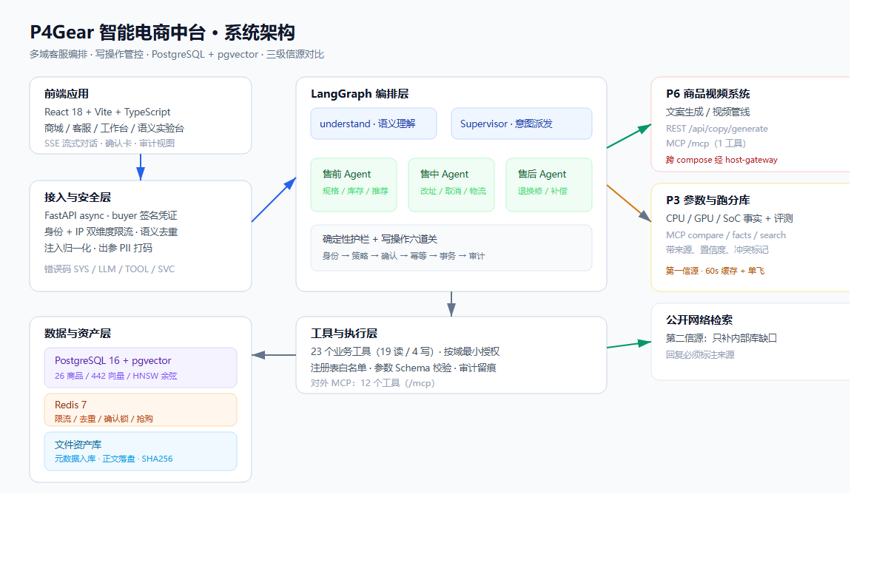

# 系统架构说明

[← 返回 README](../README.md) · [文档索引](README.md) · [English README](../README.en.md)

P4Gear 采用单体 FastAPI 服务 + React 前端的结构，内部按「包边界」分层：接入、编排、工具、数据四层单向依赖，跨层只走显式接口。这样不必为演示项目背上多服务部署成本，同时保留把编排层或工具层独立拆出去的余地。

## 总览

| 层 | 职责 | 关键实现 |
| --- | --- | --- |
| 前端应用 | 商城、客服工作台、语义实验台、审计视图 | React 18 + Vite + TypeScript，手写 SSE 解析 |
| 接入与安全 | 鉴权、限流、去重、注入归一化、错误码收口 | FastAPI async、buyer 签名凭证、身份 + IP 双维度限流 |
| LangGraph 编排 | 语义理解、意图派发、域 Agent 协同 | `StateGraph` + contextvar Runtime，理解 → Supervisor → 域节点 |
| 工具与执行 | 工具注册、参数校验、权限裁剪、写操作管控 | 23 个业务工具（19 读 / 4 写），按域最小授权，审计留痕 |
| 数据与资产 | 业务存储、向量检索、缓存与锁、文件资产 | PostgreSQL 16 + pgvector、Redis 7、本地资产卷 |

## 请求主链路

1. **接入**：校验会话凭证，按身份与 IP 双维度限流；对输入做注入归一化、PII 打标与语义去重，重复提问直接复用上一次结果。
2. **理解**：改写指代、识别意图与槽位，多意图时拆成有序子任务；纯查询类请求在这一步就能确定要调的工具集。
3. **派发**：Supervisor 按业务域把子任务交给售前 / 售中 / 售后 Agent，跨域交接写入审计，不允许一个 Agent 代另一个域做写操作。
4. **执行**：Agent 只能看到本域注册的工具；工具入参过 Schema 校验，返回值带来源与置信度标记。
5. **落库**：读操作直接返回；写操作必须依次通过六道关，任一关失败即中止并给出结构化错误码。
6. **输出**：SSE 按 `token / meta / error / done` 分帧，前端用确认卡承接需要用户二次确认的动作。

## 多 Agent 编排

- **understand**：单次模型调用完成改写、意图、槽位与多意图拆解，结果同时供 NLU 实验台复用。
- **Supervisor**：只做路由，不持有业务工具；按意图与槽位把任务分给域 Agent，冲突时按「售后 > 售中 > 售前」的优先级收口。
- **域 Agent**：三个域各自持有工具白名单与提示词，跨域信息通过只读查询获取，写操作一律回到本域。
- **确定性护栏**：策略判定、库存扣减、幂等键生成都由代码完成，模型输出只作为建议，不直接决定写库。

这样拆的代价是多一次模型调用与状态传递，收益是权限边界清晰：即使提示词被诱导，域 Agent 也拿不到别的域的工具。

## 写操作六道关

| 顺序 | 关卡 | 作用 | 失败表现 |
| --- | --- | --- | --- |
| 1 | 身份 | 确认会话属于当前买家，拒绝代客操作 | `SYS_AUTH` |
| 2 | 策略 | 退款、补偿、取消等规则由策略引擎判定 | `SYS_POLICY` |
| 3 | 确认 | 生成确认卡，用户确认后才执行，会话级锁防重复点 | `SYS_CONFIRM` |
| 4 | 幂等 | 以会话 + 动作 + 参数生成幂等键，重复请求返回原结果 | 幂等命中，直接返回 |
| 5 | 事务 | 库存、订单、审计同事务提交，失败整体回滚 | `SYS_TXN` |
| 6 | 审计 | 记录操作者、入参、策略结论与结果，供追溯 | 审计写失败即回滚 |

读工具不经过六道关，但同样受域授权与限流约束。

## 工具与权限

- **业务工具 23 个**：19 个读（商品、库存、订单、物流、政策、文件、向量检索等）、4 个写（下单、取消、改地址、退换修受理）。
- **对外 MCP 12 个工具**：把商品卡、检索、库存、政策等只读能力暴露给 P6 等外部系统，不暴露写工具。
- **外部 MCP 接入**：P6 商品视频 1 个工具，P3 参数事实库 4 个工具（compare / facts / search / status）。
- **注册表**：工具以声明式注册，含域、读写属性、参数 Schema、超时与降级策略；新增工具不改编排代码。

## 数据与检索

- **业务库**：PostgreSQL 16，16 张表，启动时 `create_all` 幂等建表；本地可退化为 SQLite。
- **向量**：`doc_embeddings` 原生 SQL 建表，`vector(1024)` + HNSW 余弦索引；78 份文档切 416 章节，442 条向量；换 embedding 模型需停写、改维度、删表、全量重灌。
- **缓存与锁**：Redis 负责限流计数、语义去重、确认单锁与抢购扣减；`memory` 后端用于零依赖本地运行。
- **文件资产**：元数据（`rel_path`、`sha256`、`size`、来源）入库，正文落 `STORAGE_DIR`；备份先库后卷。

## 跨系统与信源

- **P6 商品视频**：REST 交换商品卡与文案，MCP 双向调用；跨 compose 网络经 host-gateway，契约见 [P4-P6-BRIDGE.md](P4-P6-BRIDGE.md)。
- **P3 参数事实库**：外设的 CPU / GPU / SoC 规格、跑分与评测走 MCP；同参数结果缓存 60 秒并做并发单飞，接入见 [P3-MCP-INTEGRATION.md](P3-MCP-INTEGRATION.md)。
- **三级信源**：严格对比时固定按「P3 内部事实 → 自营商品库 → 公开网络」取值，每层结果带来源标记，公开网络只补内部缺口，规则见 [SOURCE-PRIORITY.md](SOURCE-PRIORITY.md)。

## 可观测与质量门

- 结构化错误码分 `SYS / LLM / TOOL / SVC` 四类，SSE `meta` 帧带检索命中、信源与耗时。
- 审计表记录每次写操作与跨域交接；健康探针返回模型、缓存、RAG 与检索能力状态。
- 质量门：全量对话 22/22、安全动态 36/36、桥接 13/13、信源 7/7、结构自检 0 ERROR、静态扫描 0 FAIL、前端构建通过，详见 [reports/](reports/)。

## 设计取舍

- **单进程包边界，而非微服务**：演示与单机部署成本优先；层间只通过服务对象与注册表交互，后续拆服务不需要重写业务逻辑。
- **Mock 优先**：默认 `LLM_BACKEND=mock`，编排、工具、写操作链路可离线全量验证，接真实模型只换配置。
- **SSE 而非 WebSocket**：客服场景是单向流式输出，SSE 更简单，断线重连与代理兼容性更好。
- **策略前置**：退款、补偿这类高风险判定不交给模型，模型只负责解释与收集槽位。

## 相关文档

- [文档索引](README.md)
- [运维手册](OPS_RUNBOOK.md)
- [P4-P6 桥接契约](P4-P6-BRIDGE.md)
- [P3 MCP 接入](P3-MCP-INTEGRATION.md)
- [信源优先级](SOURCE-PRIORITY.md)
